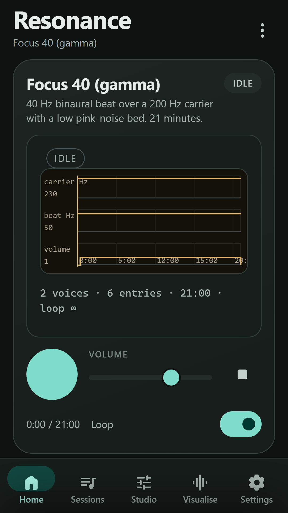
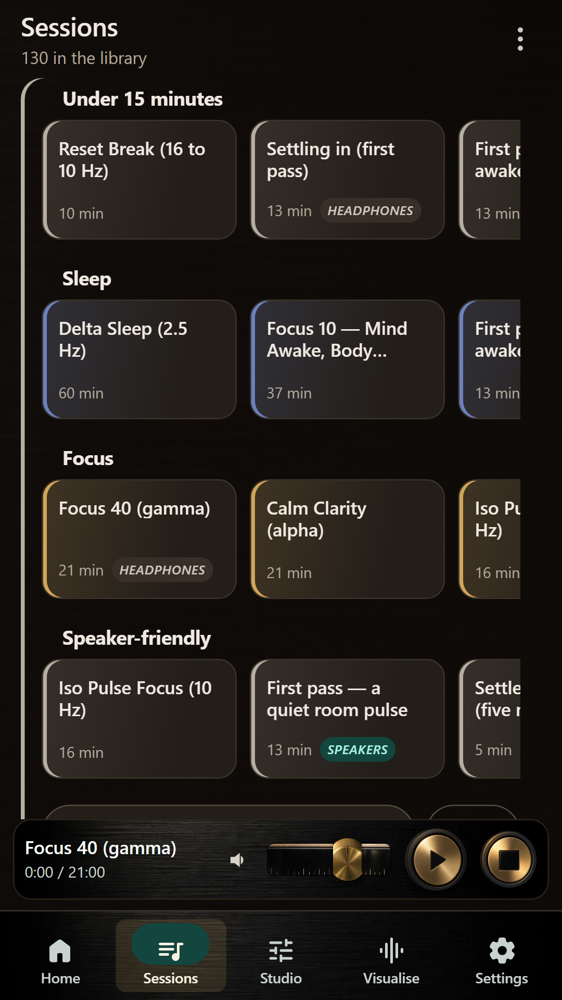
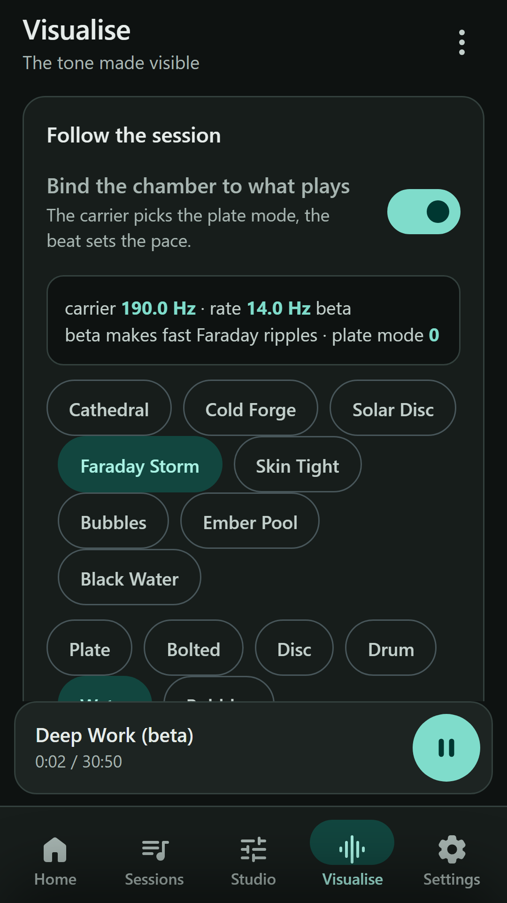
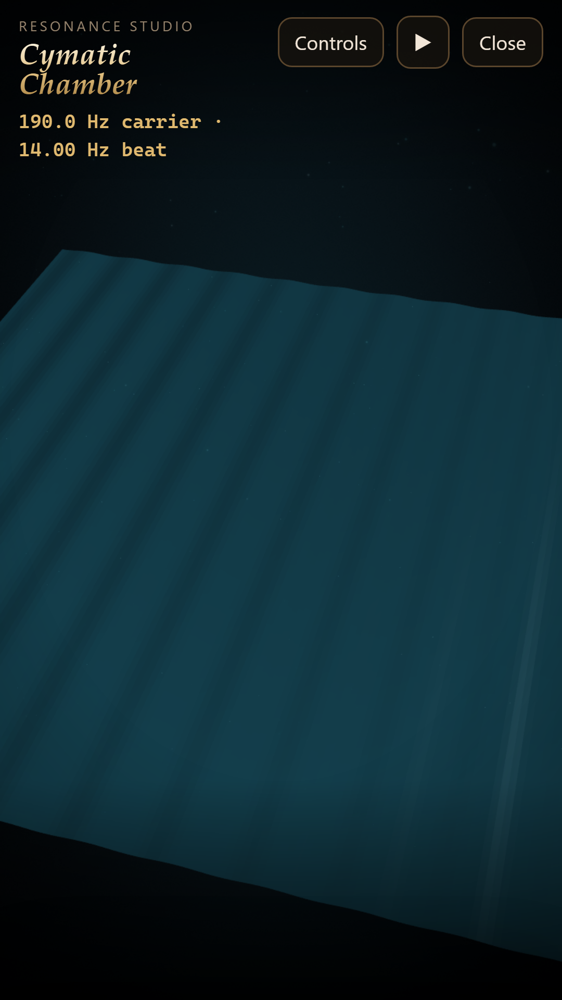
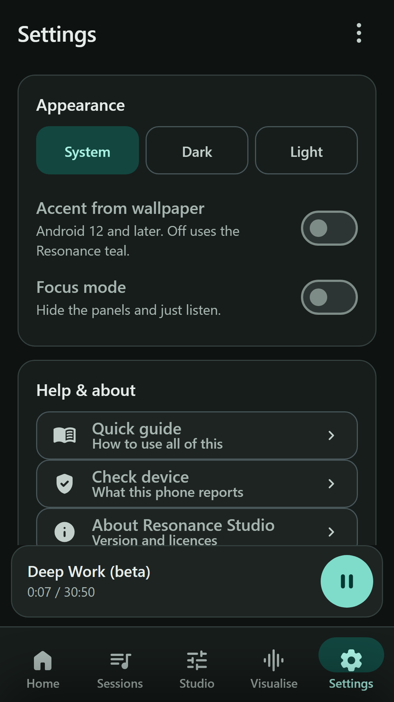

# Resonance Studio — Android

[](COPYING)

[](https://github.com/ModdySwag/resonance-android/releases)

**The tone, beat and noise studio, built for a phone.**

Resonance Studio plays binaural and monaural beats, isochronic pulses and noise beds — a
hundred ready sessions, a real schedule engine underneath, and a visualiser that shows what
the tone does to a plate, to water, to a cloud of bubbles. Everything is synthesised on the
device: no stream, no account, no upload, works in a tunnel.

This is the mobile arm of [Resonance Studio](https://moddys.net/resonance/). Since 2.0 it is no
longer the desktop page with a bar bolted on — it is a purpose-built Android app, and the web
studio is the engine it drives.

## What it does

- **Home starts a sound in one tap.** Sleep, Focus, Relax and Wake tiles, a build-a-tone panel
  (carrier, beat, optional noise bed) and the current session with its own transport.
- **A real library.** 100+ sessions with search, packs, favourites and a headphones/speaker
  split, all editable in place. Nothing is locked, there is nothing to buy.
- **A Visualise section bound to the session.** The cymatic chamber resolves your carrier onto
  its mode ladder and breathes at your beat; the medium follows the voice type, and the screen
  prints the mapping so it is never a mystery. Sand on a plate, ripples on water, bubbles, dust.
- **A studio when you want one.** Voices and entries with the page's own schedule editor, live
  meter, session timer, breathing pacer and an instant mute.
- **Files a phone can live with.** `Open .gnaural`, `Add pack (.zip)`, `Save .gnaural`,
  `Export WAV` of any length and every pack download land in `Downloads/Resonance Studio`.
- **Keeps playing, screen off.** A `mediaPlayback` foreground service and a partial wake lock
  keep the session alive; the notification and lock screen carry pause and stop. The service
  asks for no audio focus — the WebView's engine already does, once per app.
- **Material 3, dark and light.** Tonal surfaces, 48 dp targets, screen-reader labels, reduced
  motion support, an accent that can follow your wallpaper, and a nav you can work with one
  thumb.

## Screenshots

    

## Quick start

The build runs in GitHub Actions, so you don't need the Android SDK here.

1. Push this repo (or **Actions → Build APK → Run workflow**).
2. Take the **resonance-debug-apk** artifact when it goes green — or tag `v*` for a signed
   release APK **and** the `.aab` the store wants.
3. Copy the APK to your phone, allow "install unknown apps" for your file manager when asked.
   Android warns about unknown developers; that is the sideload flow, not a fault in the build.

The signed APK is also on **moddys.net/moddys-downloads.html**, byte-identical to the GitHub
asset.

Note: the debug artifact is a *different package* (`…​.debug`) signed with the CI debug key.
Uninstall it before installing a signed release or you will have two apps.

Local build: JDK 17, `platforms;android-35`, `build-tools;35.0.0`, then
`gradle :app:assembleDebug`.

## Play Store release

`store/` carries the whole submission pack: icon, feature graphic, seven 1080×1920 shots
rendered from this build, the listing copy with counted fields (`tools/check_listing.py`),
the data-safety answers with their evidence, and the privacy page.

```bash
python tools/play_assets.py     # regenerate the assets from the app
python tools/site_shots.py      # and the moddys.net downloads card's shots
python tools/check_listing.py   # limits, sizes, shot count
```

The screenshots are web renders of the shipped build — the notification and lock screen only
exist on a device, and the listing says so.

## Refreshing the bundled web app

`app/src/main/assets/www/` is a snapshot with a sha256 manifest; CI checks every file before
building, so a hand-edit cannot slip out unrecognised. After the site changes:

```bash
python tools/sync-assets.py            # from C:\Users\Moddy\webmusic-hub\site\resonance
python tools/sync-assets.py --from-url # or pull what is live
python tools/sync-assets.py --check    # or just look for drift
```

The shell is the one file that is ours: `app/src/main/assets/www/_shell_shim.js`. The rest of
`www/app` must stay byte-identical to the site.

## How it fits together

| file | role |
|---|---|
| `MainActivity.java` | serves the bundled files from the APK over `appassets.androidplatform.net`, injects the shell, edge-to-edge insets, back handling |
| `_shell_shim.js` | the entire app UI: navigation, screens, visualise binding, file paths, state to the service |
| `PlaybackService.java` | foreground service, MediaSession, notification and lock-screen controls |
| `Compat.java` · `Updates.java` | launch compatibility notice · self-update via the site's feed |
| `tools/shim_harness.py` | the acceptance gate: 71 checks against the real page in a real browser |
| `tools/validate_android_project.py` · `tools/apk_identity.py` | static pre-flight · published-APK identity and signature proof |

Nothing about playback is reimplemented: every button calls the page's own
`window.__gnauralAPI`, and every fact comes from the page's own DOM and state.

## Privacy & safety

**Nothing is collected.** No analytics, no ads, no account, no upload. Preferences, favourites
and imported packs live in `localStorage` on the phone; saved files go only where you choose.
The only network use is the update check (a plain JSON fetch, no identifier) and the help pages,
which open in your browser. Read the full [privacy statement](https://moddys.net/resonance/privacy/).

**Use headphones for binaural sessions** — the beat is made in your hearing, not in the file.
The Speakers pack and isochronic pulses work on any loudspeaker. Keep volumes moderate; if you
have to raise your voice to be heard at arm's length it is too loud. If you have epilepsy or a
seizure disorder, ask a clinician before using repetitive pulsed tones. Not a medical device or
treatment.

## Known limitations

- Binaural beats need headphones. That is physics, not a missing feature.
- The visualiser's WebGL path needs a reasonably modern WebView; older ones fall back to 2D.
- The app is one page served from the APK, so help and credits open in the browser rather than
  inside the app.
- Play availability, the AAB and listing review are new in 2.0 and still need a real submission.

## Licence

Gnaural Web is a browser re-implementation of Gnaural's scheduling engine and `.gnaural`
format. Gnaural is © Bret Logan and contributors; the ported engine keeps LGPL-2.1-or-later,
everything else is GPL-2.0-or-later. Not affiliated with the upstream project, the Monroe
Institute or any other programme.

Cheers Moddy !
