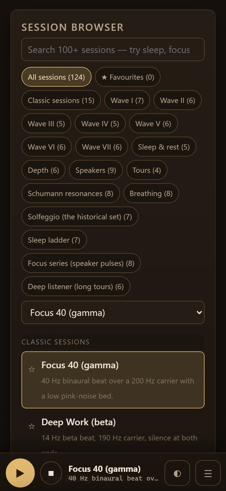
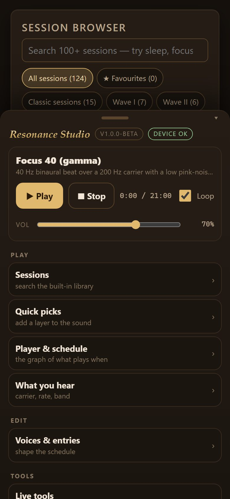
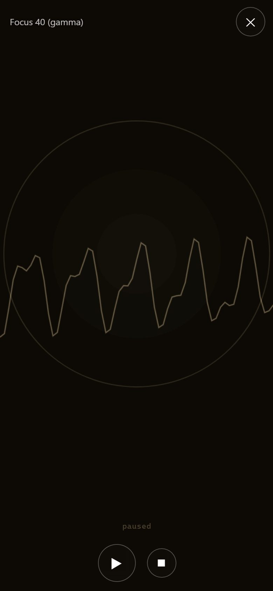
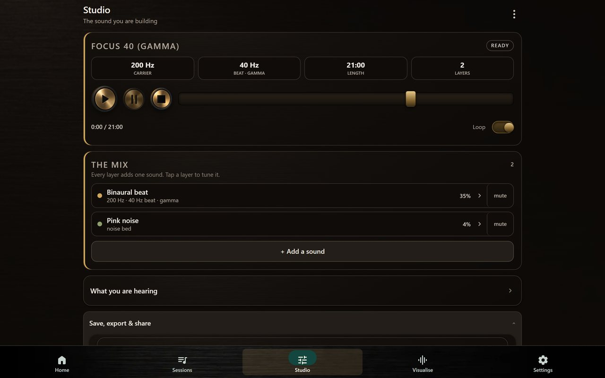

# Resonance Studio v1.1.0-beta (Android)

The Cymatic Chamber arrives on the phone: a separate, full-screen instrument that takes the session's
own carrier and beat, solves the vibration modes of a real plate, and draws the figure that tone
actually drives. Sand collects on the nodal lines; the mode ladder lets you drive any mode exactly;
the readout gives the nearest mode and the detuning in cents.

Six media, each solved rather than painted: a free steel plate (Rayleigh-Ritz, Leissa's frequencies),
the classical centre-bolted plate, a clamped disc (Bessel modes), a circular drum, Faraday waves on
water (the true gravity-capillary wavelength at half the drive), and bubble acoustics (Minnaert
resonance and Bjerknes forces). The free plate reproduces the published lambda-squared table to three
decimals, and the sand measurably converges on the nodal set.

It opens from the menu, or from the website's header. Everything else is the studio you know - the
same engine, the same sessions, the same offline packs.

# Resonance Studio v1.0.0-beta (Android)

The studio's first Android build: the full Gnaural Web engine — binaural and monaural beats,
isochronic pulses, noise beds, the session library, the schedule editor and the visualizers —
with the things a phone needs added around it, and nothing about the web app changed.

A look at the Android build:

  

## What's in it

**A player bar that follows you.** Play/pause, stop, the session name, the clock, fullscreen
visualizer and the menu, pinned across the bottom. The desktop header is gone; its controls
still run everything.

**A menu that explains the app.** Drag the bar up: Sessions, Quick picks, the schedule graph,
what you are hearing, Voices & entries, Live tools (meter · timer · pacer · mute), Files &
export, Pack downloads, the visualizer, skins, focus mode — each one jumps to the real thing.
Plus a Quick guide, the device check and the update check.

**A fullscreen visualizer.** Tap any visual panel — or the ◐ button — and it fills the screen,
with a small translucent play/pause embedded at the bottom. Tap the picture to hide the
controls; back or the X returns. All of it reads off the same engine phase the site's panels do.

**Keeps playing with the screen off.** A foreground service and wake lock keep the session
alive; the notification and lock screen have pause and stop. No audio-focus claim — one owner,
the WebView's engine, like any media app.

**Batteries of files, saved properly.** Open .gnaural and import .zip packs through the system
picker; Save .gnaural, Export WAV and Pack downloads all land in Downloads/Resonance Studio.
Pack archives are bundled — that part works with no network at all.

**Share links that open anywhere.** Copy share link rewrites the app's origin to
moddys.net/resonance, ready to paste.

## Verified

- `tools/shim_harness.py` — 44 checks, 0 failed, driving the real page in a real browser:
  the bar plays/pauses/stops the actual session (the clock advances), the service gets the
  playing state and the session name, the menu opens/toggles/jumps, the skin and focus rows
  drive the page's own controls, the fullscreen visualizer fills the screen and is measured
  painting, a .gnaural save streams byte-exact (compared against the page's own output), a
  pack download saves the bundled zip, the share link comes back as a moddys.net URL, the
  quick guide / check report / update strip all work, and a reload rebuilds the bar
- the static ladder on the repo: every XML, every resource reference, every bundled script,
  the workflows, all four Java sources
- the bundled web app is byte-identical to what moddys.net serves (sha256 manifest, checked
  in CI and again against the built APK's contents)
- the APK's signing certificate is the release keystore (fingerprint 08:B8:CB:…:B6), decoded
  from the shipped file rather than a build log — and the site's copy is the same bytes

## Install

Two ways to get it, same signed file either way: the card on
**moddys.net/moddys-downloads.html**, or the APK attached to this release.

Copy the APK to your phone and open it. Android will ask you to allow "install unknown apps"
for whichever app is opening it, and Play Protect will warn about an unknown developer — that
is the sideload flow, not a problem with the build.

This first version installs the way you installed it. From the next version on, the app
updates itself — one tap on **Update now**, and the download is checksum-verified against the
site's feed before Android asks to install it.

## Known limitations

- this first version installs by hand; from the next one, **Update now** in the app does it
- swiping the app away ends the session (Android gives the WebView no life after the task)
- help and credits open in the browser; the Quick guide in-app covers the essentials offline
- this is a beta: background playback across every OEM's battery manager is the thing to
  live-test, and the Check panel exists to make any device that misbehaves diagnosable

## Cheers Moddy !
